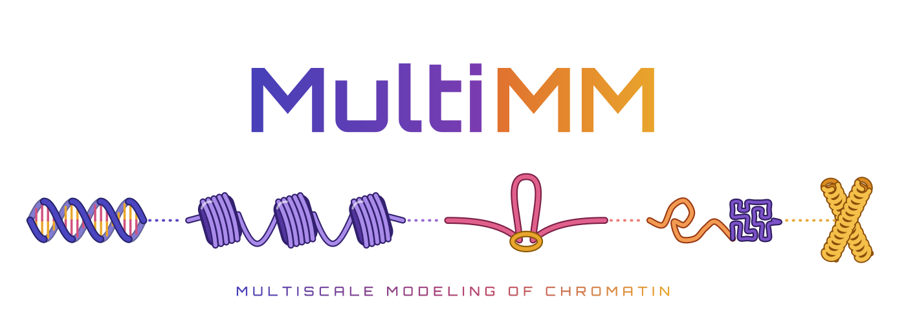

<p align="center">
  
</p>

**MultiMM** is an [OpenMM](https://openmm.org)-based tool for building 3D models of chromatin, from single genomic regions to the whole human genome. It is *multiscale*: one energy function covers nucleosomes, loops and TADs, A/B compartments, chromosome territories and the nucleus. You give it loop calls, and optionally compartments or a Hi-C map, and it returns a 3D structure that you can open in any molecular viewer. The model is fast because it starts from a compact Hilbert-curve conformation and runs on GPUs through OpenMM.

<p align="center">
  
</p>

## Install

```bash
pip install MultiMM
```

Requires Python 3.10 or newer. Linux is the main platform; macOS works without CUDA. See the documentation for installation from source.

## Run

All settings live in one config file:

```bash
MultiMM -c config.ini
```

Any setting can also be overridden on the command line, for example `--n_beads 2000`.

## A config file

You only write what you want to change; everything else has a default.

```ini
[Main]
CHROM            = chr1
LOC_START        = 160_000_000
LOC_END          = 173_000_000
N_BEADS          = 5000

LOOPS_PATH       = data/loops.bedpe          ; chromatin loops
COMPARTMENT_PATH = data/compartments.bed     ; optional A/B compartments
COB_USE_COMPARTMENT_BLOCKS = True

OUT_PATH         = results/chr1_region
```

## Documentation

The full documentation, with the mathematics of every force and a table of all arguments, is written with [MkDocs](https://www.mkdocs.org) and its source is in [`docs/`](docs). To read it locally:

```bash
pip install mkdocs-material
mkdocs serve
```

## Citation

If you use MultiMM in your research, please cite:

> Korsak, Sevastianos, Krzysztof Banecki, and Dariusz Plewczynski. "Multiscale molecular modeling of chromatin with MultiMM: From nucleosomes to the whole genome." *Computational and Structural Biotechnology Journal* 23 (2024): 3537–3548.

## License

MultiMM is free software, distributed under the GNU General Public License v3.0.
