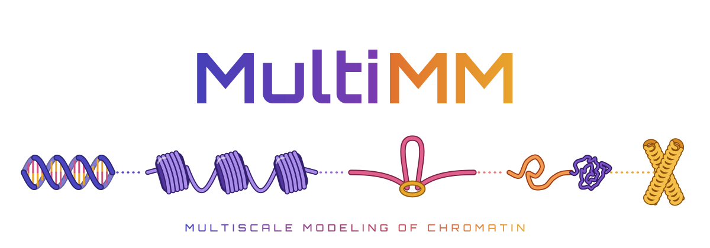
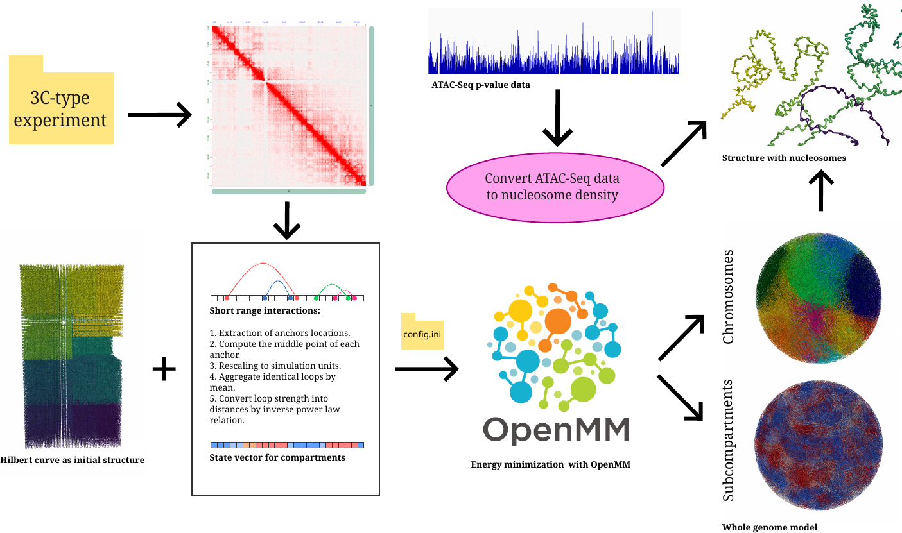

<p align="center">
  
</p>

**MultiMM** is an [OpenMM](https://openmm.org)-based tool for building 3D models of chromatin, from single genomic regions to the whole human genome. It is *multiscale*: one energy function covers nucleosomes, loops and TADs, A/B compartments, chromosome territories and the nucleus. You give it loop calls, and optionally compartments or a Hi-C map, and it returns a 3D structure that you can open in any molecular viewer. The model is fast because it starts from a compact Hilbert-curve conformation and runs on GPUs through OpenMM.

<p align="center">
  
</p>

## Scales of modelling

One energy function ties together five scales. Each is a different way of looking at the same chain of beads.

| Scale | What it means | How MultiMM models it |
|---|---|---|
| **Nucleosome / fibre** | DNA wrapped around histones, forming a ~10 nm fibre | Beads joined by bonds and angle (stiffness) terms, with excluded volume so beads do not overlap |
| **Loops** | Pairs of distant sites held together, e.g. by CTCF and cohesin | Harmonic springs between loop anchors, taken from your loop file |
| **TADs / Hi-C contacts** | Domains that fold together more than with their surroundings | Optional restraints derived from a Hi-C map by Boltzmann inversion |
| **A/B compartments** | Active (A) and inactive (B) chromatin that cluster by type | Soft attraction between beads of the same compartment type |
| **Chromosomes and nucleus** | Chromosome territories inside a nucleus, anchored at the lamina | Container wall, lamina and chromosome-block forces |

## Install

From PyPI:

```bash
pip install MultiMM
```

With [uv](https://docs.astral.sh/uv/) (fast, isolated):

```bash
uv pip install MultiMM          # into the current environment
uv tool install MultiMM         # or as a standalone command-line tool
```

For `.hic` Hi-C files, also install the optional reader (`pip install "MultiMM[hic]"`); `.cool` and `.mcool` files work out of the box.

Requires Python 3.10 or newer. Linux is the main platform; macOS works without CUDA. The documentation covers installation from source.

## Run

All settings live in one config file:

```bash
MultiMM -c config.ini
```

Any setting can also be overridden on the command line, for example `--n_beads 2000`.

## A config file

You only write what you want to change; everything else has a default.

```ini
[Main]
CHROM            = chr1
LOC_START        = 160_000_000
LOC_END          = 173_000_000
N_BEADS          = 5000

LOOPS_PATH       = data/loops.bedpe          ; chromatin loops
COMPARTMENT_PATH = data/compartments.bed     ; optional A/B compartments
COB_USE_COMPARTMENT_BLOCKS = True

OUT_PATH         = results/chr1_region
```

## Documentation

The full documentation, with the mathematics of every force and a table of all arguments, is written with [MkDocs](https://www.mkdocs.org) and its source is in [`docs/`](docs). To read it locally:

```bash
pip install mkdocs-material
mkdocs serve
```

## Development

```bash
git clone https://github.com/SFGLab/MultiMM.git
cd MultiMM
uv sync --extra dev             # or: pip install -e ".[dev]"
```

Run the tests (all are quick checks, no full simulation, about half a minute):

```bash
uv run pytest -q                # or: pytest -q
uv run pytest tests/test_force_signs.py   # a single file
```

Console output has four levels: no flag shows only the pipeline stages and progress bars; `-v` adds details, `-vv` adds statistics tables, `-vvv` is fully verbose.

## Citation

If you use MultiMM in your research, please cite:

> Korsak, Sevastianos, Krzysztof Banecki, and Dariusz Plewczynski. "Multiscale molecular modeling of chromatin with MultiMM: From nucleosomes to the whole genome." *Computational and Structural Biotechnology Journal* 23 (2024): 3537–3548.

## License

MultiMM is free software, distributed under the GNU General Public License v3.0.
