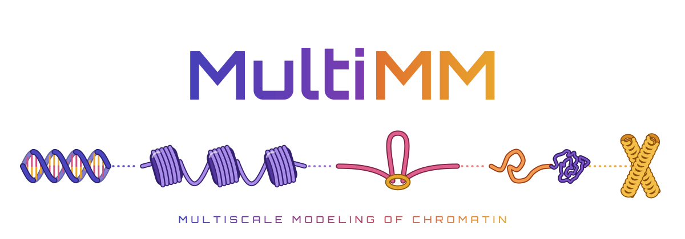
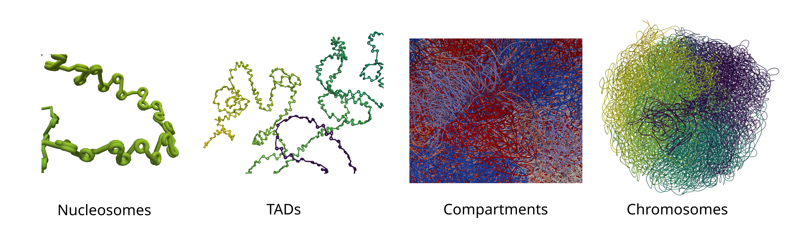

  

# MultiMM

Welcome! **MultiMM** is a program that turns experimental data about the genome into a **3D picture of chromatin**, from a single gene up to the whole nucleus. It is built on [OpenMM](https://openmm.org), a fast simulation engine, and it is **multiscale**: one model can describe several levels of chromatin organisation at once, and you decide which ones to switch on.

You do not need to be a physicist to use it. If you are a biologist, you can run it with a short settings file and some data. If you are curious about *how* it works, the documentation explains every ingredient step by step, with pictures, and every new symbol is introduced when it first appears. It is written to be readable in your first year of physics, biology or computer science.

## The main idea

Chromatin is a very long string of DNA and proteins, a *polymer*. Imagine it as a necklace of $N$ beads, where each bead stands for a stretch of the genome (for example 10 kb, that is 10 000 DNA letters). The question is: how is this necklace folded in 3D? We answer it by giving the necklace an **energy** that is low when the folding agrees with the experiments and high when it does not, and then letting the computer find the shape with the lowest energy:

$$
E = E_\text{backbone} + E_\text{data} + E_\text{nucleus},
$$

built from three kinds of ingredients:

- **Backbone** ($E_\text{backbone}$): keeps the chain connected, stiff and self-avoiding. This part needs no data.
- **Data-driven forces** ($E_\text{data}$): translate experimental measurements into attractions and restraints. Chromatin **loops** (ChIA-PET, HiChIP, Hi-C loop calls), **A/B compartments**, or a raw **Hi-C contact matrix** each become a force on the beads.
- **Nuclear environment** ($E_\text{nucleus}$): a spherical container, anchoring of B-compartment chromatin to the nuclear lamina, chromosome territories and nucleolar positioning. These matter for chromosome- and genome-scale runs.

Each term is a separate switch in the configuration file, so the same program covers very different questions with very different input data.

Two design choices make it fast:

1. **GPU parallelisation** through OpenMM (CUDA or OpenCL), with a CPU fallback.
2. **A Hilbert curve as the starting conformation.** A Hilbert curve is a space-filling curve that already folds the chain into a compact, territory-like shape in which genomic neighbours are also spatial neighbours. The optimiser therefore starts close to a sensible answer instead of from a random coil (see [Initial structure](model/initial-structure.md)).

## What can I model?

Choose the level that matches your question; MultiMM sets sensible defaults for it.

| Level | Scope | Typical forces |
|---|---|---|
| `GENE` | A gene and its flanking region | backbone + loops or Hi-C force |
| `REGION` | A user-defined interval (a TAD, a locus, a few Mb) | backbone + loops or Hi-C force (+ compartments) |
| `CHROM` | A whole chromosome | backbone + loops/Hi-C + compartments |
| `GW` | All chromosomes in one nucleus | full force field, including nucleus and lamina |

Optionally, a finished structure can be refined to **nucleosome resolution** using ATAC-seq (see [Advanced options](model/advanced.md)).

## Where to go next

- New here? Start with [Installation](intro/installation.md), then try the quick example in the project README.
- Want to understand what the program computes? Read [The Model](model/index.md). Every force is explained with its equation and with the exact choices MultiMM makes.
- Ready to run your own data? Go to the [Reference](reference/running.md): how to run, how to write a config file, and a table of every argument.

!!! note "Scope"
    MultiMM is designed for human genome data. Other organisms may work with additional modifications, but full support is not guaranteed. It accepts input derived from Hi-C, single-cell Hi-C, ChIA-PET and HiChIP experiments. Default parameters are tuned for population-average Hi-C; please check convergence on your own data.
