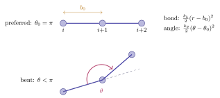
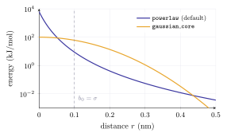

# Backbone

The backbone is the part of the force field that needs **no experimental data**. It makes the beads behave like a chromatin fibre: a connected chain with some stiffness that cannot pass through itself. All other forces act on top of it.

!!! tip "In plain words"
    Think of a string of pearls. Each pearl is tied to its neighbours by a short spring (**bond**), the string resists sharp bending like a garden hose (**angle**), and no two pearls can sit in the same place (**excluded volume**, a kind of personal space).

{ width="560" }

## Bonds

Consecutive beads are connected by a harmonic spring,

$$
E_\text{bond}=\sum_{i}\frac{k_b}{2}\,\bigl(r_{i,i+1}-b_0\bigr)^2 ,
$$

where $r_{i,i+1}$ is the distance between beads $i$ and $i+1$, $b_0$ is the rest length and $k_b$ the stiffness. With the defaults a bond fluctuates by only $\sqrt{k_BT/k_b}\approx 0.003$ nm, about 3% of $b_0$, so the chain is practically inextensible: bonds define *connectivity*, not elasticity. Bonds are not created across a chromosome boundary, so every chromosome is its own chain.

!!! question "Why this force, and what does it model?"
    DNA is a continuous molecule, so neighbouring beads must stay neighbours. A stiff spring is the simplest way to say this, and a spring is also what the computer handles best: its energy is smooth and its force is easy to compute. The spring is made so stiff that the chain is practically inextensible, so it models *connectivity*, not stretchiness.

## Angles (stiffness)

Chromatin cannot bend arbitrarily sharply. Stiffness is a harmonic term on the angle $\theta_i$ formed by three consecutive beads,

$$
E_\text{angle}=\sum_{i}\frac{k_\theta}{2}\,\bigl(\theta_i-\theta_0\bigr)^2 .
$$

With $\theta_0=\pi$ the preferred shape is a straight line and $k_\theta$ penalises bending. Bond plus angle form a discretised **worm-like chain**. In the weak-bending limit its *persistence length* (the contour length over which the chain keeps its direction) is about

$$
\ell_p\approx b_0\,\frac{k_\theta}{k_BT}\;\approx\;39\,b_0\quad\text{for the defaults.}
$$

This is only a guide, because excluded volume and the data forces also bend the chain, but it shows how to tune stiffness: doubling $k_\theta$ roughly doubles $\ell_p$.

!!! question "Why this force, and what does it model?"
    Chromatin has a real thickness, so the fibre cannot pass through itself. Without this term the chain would collapse into a point, or pass through itself like a ghost, which topoisomerases and the physical fibre forbid. The angle term models the fact that a 10 nm to 30 nm fibre is not a floppy thread but resists sharp bends (the *persistence length* is the distance over which it keeps its direction).

## Excluded volume

Two beads must not occupy the same place. A repulsive, **soft-core** interaction acts between *all* pairs of beads, including chain neighbours. Two functional forms exist; both use the size $\sigma$ (set from `LE_HARMONIC_BOND_R0`, 0.1 nm) and the strength $\varepsilon$.

{ width="560" }

| `EV_FORCE_TYPE` | Energy per pair | Character |
|---|---|---|
| `powerlaw` (**default**) | $\varepsilon\left(\dfrac{\sigma}{r+r_s}\right)^{n}$ | Steep repulsion that grows quickly as beads approach. The small length $r_s$ (`EV_R_SMALL`) keeps it finite at $r=0$, where it equals $\varepsilon(\sigma/r_s)^n$ (6400 kJ/mol for the defaults), so the minimiser never meets an infinity. At $r=b_0$ it is only about 9 kJ/mol, so chain neighbours feel a mild, nearly constant offset. |
| `gaussian_core` | $\varepsilon\,e^{-r^2/(2\sigma^2)}$ | A *very* soft core: finite ($=\varepsilon$) at full overlap and negligible beyond about $3\sigma$. It lets beads pass through each other, which is useful when a structure is badly crowded and needs to relax. It uses neither $n$ nor $r_s$. |

!!! info "In MultiMM"
    | Term | Keys | Defaults |
    |---|---|---|
    | Bond | `POL_USE_HARMONIC_BOND`, `POL_HARMONIC_BOND_R0` ($b_0$), `POL_HARMONIC_BOND_K` ($k_b$) | `True`, 0.1 nm, 300 000 kJ mol⁻¹ nm⁻² |
    | Angle | `POL_USE_HARMONIC_ANGLE`, `POL_HARMONIC_ANGLE_R0` ($\theta_0$), `POL_HARMONIC_ANGLE_CONSTANT_K` ($k_\theta$) | `True`, 3.14159 radian, 100 kJ mol⁻¹ rad⁻² |
    | Excluded volume | `EV_USE_EXCLUDED_VOLUME`, `EV_FORCE_TYPE`, `EV_EPSILON` ($\varepsilon$), `EV_POWER` ($n$), `EV_R_SMALL` ($r_s$) | `True`, `powerlaw`, 100 kJ/mol, 6, 0.05 nm |

    The excluded-volume size $\sigma$ has no key of its own: it is read from `LE_HARMONIC_BOND_R0` (default 0.1 nm, equal to $b_0$). The Hi-C force also uses it as its minimum distance. Angles are omitted at chromosome boundaries.

!!! tip "Rule of thumb"
    Leave the backbone at its defaults unless you have a reason. If the structure looks too crumpled or too straight on short scales, adjust `POL_HARMONIC_ANGLE_CONSTANT_K` first.
