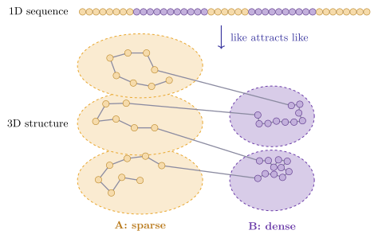
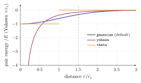
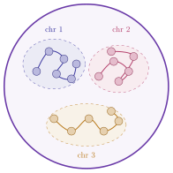
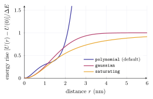

# Compartments

Loops organise chromatin locally. At the scale of megabases to whole chromosomes, the dominant pattern in Hi-C maps is the **A/B compartments**: active, open chromatin (A) contacts other A regions, and inactive, compact chromatin (B) contacts other B regions, which gives the checkerboard "plaid" pattern. MultiMM reproduces this with a **block-copolymer model**.

!!! tip "In plain words"
    Imagine two kinds of magnets mixed along one long string. Each kind sticks to its own kind. The string folds so that the same kinds end up together, and you get an active (A) neighbourhood and an inactive (B) neighbourhood.

## The physical idea

Picture one chain made of two kinds of beads, A and B, that attract their own kind and ignore the other. Like oil and water, the two kinds tend to separate, but because all beads belong to the same chain they cannot separate completely: the chain folds so that A segments gather in some places and B segments in others. This is *microphase separation*, and it explains compartments without further assumptions. B is the denser phase because it attracts itself more strongly.

{ width="700" }

## Compartment states

Each bead carries a state $s_i$:

| $s_i$ | Meaning | From a CALDER label |
|---|---|---|
| $+2$ | A1 | `A.1…` |
| $+1$ | A2 (or A without subtype) | `A.2…` |
| $-1$ | B1 (or B without subtype) | `B.1…` |
| $-2$ | B2 | `B.2…` |
| $0$ | unassigned (no data) | no annotation |

The sign tells A from B (A beads have $s_i>0$, B beads $s_i<0$) and the magnitude tells the subtype. The states come from one of three sources: a **CALDER `.bed`** file (A/B plus four subcompartments), a **`.bw` / `.bigWig` signal track** such as a Hi-C eigenvector (the signal is centred, scaled to $[-1,1]$ and discretised; **higher values become B, lower values A**; A/B only), or the **Hi-C matrix itself** via its first principal component ([Hi-C force](hic-force.md)).

## Compartment interaction

Beads of the same compartment attract each other. With $\mathbb 1_A(s)=\delta(s-1)+\delta(s-2)$ and $\mathbb 1_B(s)=\delta(s+1)+\delta(s+2)$ marking A and B beads, the energy of a pair $(i,j)$ is

$$
U_{ij}=-\Bigl[E_A\,\mathbb 1_A(s_i)\mathbb 1_A(s_j)+E_B\,\mathbb 1_B(s_i)\mathbb 1_B(s_j)\Bigr]\;g(r_{ij}),
$$

where $E_A,E_B$ are the strengths and $g(r)$ is a **range function**. Three choices of $g$ are available (`COB_FORCE_TYPE`). The characteristic length $r_c=R_2/3$ is described in [Units and scales](scales.md).

{ width="560" }

| `COB_FORCE_TYPE` | $g(r)$ | Character |
|---|---|---|
| `gaussian` (**default**) | $e^{-r^2/(2r_c^2)}$ | Smooth and bounded: the attraction is strongest at contact and fades gradually. Gentle on the minimiser. |
| `yukawa` | $e^{-r/r_c}/r$ | A "screened" attraction. It is *not* bounded: it grows strongly at very short distance and has a longer tail than the Gaussian. Relies on excluded volume to stay finite at $r\to0$. |
| `theta` | $\Theta(r_c-r)$ (1 inside $r_c$, 0 outside) | A square well: a constant attraction for every pair closer than $r_c$. A pure "contact" rule with a sharp edge. |

In the figure, the dotted line marks $r_c$ (the length scale of the kernels) and the dashed line marks the **cutoff**: beyond it, in the grey region, pairs feel no force at all. For $N=1000$ the cutoff ($0.5$ nm) lies at $1.5\,r_c$. **Every form is cut off at $5b_0$ by default** (0.5 nm with the default $b_0$), independent of $N$, and you can change it with `COB_CUTOFF` (in units of $b_0$). The cutoff is deliberate: without it all pairs in the system would attract and large structures would collapse. Because $r_c=R_2/3$ grows with the system, for large $N$ ($r_c>5b_0$, roughly $N\gtrsim1500$) the cutoff, not $r_c$, sets the real range. A larger `COB_CUTOFF` lets like regions feel each other from further away (stronger segregation, slower runs, more risk of over-compaction); a smaller one makes the attraction purely local.

!!! warning "Known issue: `yukawa`"
    In the current source the Yukawa energy uses the state of the *first* bead twice (`s1` and `s1`) instead of `s1` and `s2`. A bead in a compartment therefore attracts *every* other bead, not only those of its own kind, so Yukawa does not segregate A from B. Use `gaussian` or `theta` for compartment modelling until this is fixed.

!!! info "In MultiMM"
    | Key | Default | Role |
    |---|---|---|
    | `COMPARTMENT_PATH` | none | `.bed` (CALDER) or `.bw` file |
    | `COB_USE_COMPARTMENT_BLOCKS` | `False` | Enable the force (requires `COMPARTMENT_PATH`) |
    | `COB_FORCE_TYPE` | `gaussian` | Range function $g$ |
    | `COB_EA`, `COB_EB` | 1.0, 2.0 kJ/mol | $E_A$, $E_B$ (B is stickier, hence denser) |
    | `COB_CUTOFF` | 5.0 (in $b_0$) | Distance beyond which the force is zero (also used by the subcompartment force) |

!!! question "Why this force, and what does it model?"
    Hi-C shows that active (A) and inactive (B) chromatin prefer their own kind, but there is no known single protein holding them together, so we model the *effect*: a short-range attraction between beads of the same type. The attraction is stronger for B, which makes B denser, as observed. Different kernels (Gaussian, Yukawa, step) only change how the attraction fades with distance.

## Subcompartments

CALDER splits each compartment into two subtypes. With `SCB_USE_SUBCOMPARTMENT_BLOCKS` each of the four states attracts **only itself**, with its own strength:

$$
U_{ij}=-\,\varepsilon_{s_i}\,\delta(s_i,s_j)\;g(r_{ij}),\qquad
\varepsilon_{+2}=E_{A1},\ \varepsilon_{+1}=E_{A2},\ \varepsilon_{-1}=E_{B1},\ \varepsilon_{-2}=E_{B2},
$$

where $\delta(s_i,s_j)$ is 1 if the two states are equal and 0 otherwise. The default energies $1.0,\ 1.33,\ 1.66,\ 2.0$ kJ/mol increase from the most open to the most compact subtype, giving a finer microphase separation inside A and B. The three range functions `gaussian` (**default**), `yukawa` and `theta` are the same as above (`SCB_FORCE_TYPE`), with the same $r_c$ and the same cutoff (`COB_CUTOFF`). Unlike the compartment force, the subcompartment Yukawa form correctly uses both beads.

!!! info "In MultiMM"
    | Key | Default |
    |---|---|
    | `SCB_USE_SUBCOMPARTMENT_BLOCKS` | `False` |
    | `SCB_FORCE_TYPE` | `gaussian` |
    | `SCB_EA1`, `SCB_EA2`, `SCB_EB1`, `SCB_EB2` | 1.0, 1.33, 1.66, 2.0 kJ/mol |

    Subcompartments need a CALDER-style `.bed`; a `.bw` track distinguishes only A from B. Both forces can be switched on together, in which case their energies add.

## Chromosome territories

In a genome-wide model every chromosome occupies its own region of the nucleus. A weak self-attraction inside each chromosome reproduces these **territories**.

{ width="360" }

With $\chi_i$ the chromosome of bead $i$, only pairs on the same chromosome interact, $U_{ij}=\Delta E\,\delta(\chi_i,\chi_j)\,h(r_{ij})$ up to the sign convention of each form. Three shapes $h$ are available (`CHB_FORCE_TYPE`), with $k_C=$ `CHB_KC` and $\Delta E=$ `CHB_DE`:

{ width="560" }

| `CHB_FORCE_TYPE` | Energy per pair (same chromosome) | Character |
|---|---|---|
| `polynomial` (**default**) | $\Delta E\,\bigl(k_Cr^4-r^3+r^2\bigr)$ | Increases with $r$ for $k_C>9/32\approx0.28$ (the default 0.3 qualifies), so same-chromosome beads are always pulled together and the pull **grows with separation** (energy $\sim r^4$). Long-ranged, unbounded. |
| `gaussian` | $-\Delta E\,e^{-k_Cr^2}$ | A soft collapse kernel: attraction only within about $1/\sqrt{2k_C}\approx1.3$ nm, and zero beyond. |
| `saturating` | $-\dfrac{\Delta E}{1+k_Cr^2}$ | Bounded, with a slow algebraic decay: it cannot over-compact a chromosome. |

The default $\Delta E=10^{-4}$ kJ/mol is tiny per pair, but the term acts on every same-chromosome pair, so its sum is large; for `gaussian` and `saturating` the same $\Delta E$ is likely too weak, and you should raise it. This force has no cutoff. It is meaningful only with several chromosomes in one model (a warning is printed otherwise).

!!! info "In MultiMM"
    | Key | Default |
    |---|---|
    | `CHB_USE_CHROMOSOMAL_BLOCKS` | `False` |
    | `CHB_FORCE_TYPE` | `polynomial` |
    | `CHB_KC` ($k_C$), `CHB_DE` ($\Delta E$) | 0.3, 0.0001 |

!!! question "Why this force, and what does it model?"
    Chromosomes in a nucleus do not mix much: each occupies its own region, a *territory*. We model this with a weak attraction between beads of the *same chromosome*. It is weak on purpose, so that it only gathers the chromosome, and does not override the other forces.

## Choices in the data

| Choice | Effect |
|---|---|
| `.bed` vs `.bw` | A/B plus subcompartments, or A/B only |
| `COMPARTMENT_FLIP_PROB` (default 0) | Probability of flipping a bead's compartment identity A↔B; models uncertainty in the A/B call and gives variety in an [ensemble](advanced.md) |
| `COMPARTMENT_NOISE_STD` (default 0) | Standard deviation of Gaussian noise added to the compartment field before it is discretised again; moves compartment boundaries slightly |

After a run, the 1D agreement with the input track and the 3D clustering of A and B beads are checked (`metadata/compartment_validation.npy`, `metadata/compartment_aggregation.npy`).
