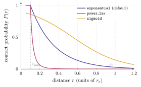
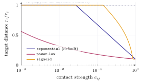
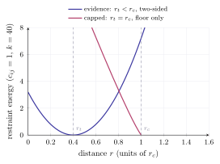

# Hi-C force

A **Hi-C map** counts how often each pair of genomic bins was found in contact. MultiMM turns this map into distance restraints between beads, so that the 3D structure reproduces the map. The idea is *Boltzmann inversion*: if contact frequency decreases with distance, a measured frequency can be converted back into a distance.

!!! tip "In plain words"
    A Hi-C map tells us which pairs of genome regions *hug* often. Pairs that hug often must be close; pairs that never hug are probably far. For every pair that hugs we tie a rubber band between the two beads, with a length that is shorter for a stronger hug. The folded structure is the one in which most rubber bands are relaxed.

## Step 1: preparing the matrix

The raw map is cleaned and brought to the bead resolution before it is used. Each step is applied in this order:

1. **Load and normalise** (`HIC_NORMALIZATION`): `KR` (default), `VC`, `VC_SQRT` or `NONE` correct experimental biases. Short runs of empty bins (up to `HIC_MAX_GAP` bins in a row) are filled by interpolation.
2. **Clean:** symmetrise, remove NaN, negative values and the diagonal.
3. **Resize** to exactly $N$ beads by weighted averaging (or interpolation if the map is coarser than the model).
4. **Optional $O/E$** (`HIC_FORCE_OE`): contacts naturally decay with genomic distance, which dominates the map. The *observed/expected* ratio divides this decay out, and the force uses only the **enrichment above background**, $\max(O/E-1,\,0)$, so that only pairs that touch more than expected attract.
5. **Denoise:** a $3\times3$ median filter removes isolated pixels, values above the 99th percentile are capped, and a light Gaussian smoothing ($\sigma=1.5$ beads) is applied.
6. **Rescale** so that the largest entry is 1. The result $c_{ij}\in[0,1]$ is the *contact strength* of beads $i,j$.

## Step 2: Boltzmann inversion, from contact strength to distance

This is the key idea of the force, so it is worth spelling out.

**Boltzmann distribution.** For a system in equilibrium at temperature $T$, the probability of finding two beads at distance $r$ is related to their interaction energy $U(r)$ by

$$
P(r)\;\propto\;e^{-U(r)/k_BT},
\qquad\text{equivalently}\qquad
U(r)=-k_BT\,\ln P(r).
$$

Low energy means high probability: pairs prefer distances where $U$ is small. The energy defined this way is called the **potential of mean force** (it includes the effect of all other beads, not only the pair itself).

**Inversion.** A Hi-C map measures how often two loci touch, which is proportional to $P(r)$ at a small distance. So the experiment gives us the *left-hand side* of the relation above, and we need the *right-hand side*: an energy that would produce these frequencies. Going from measured probabilities back to an energy (or to a preferred distance) is called **Boltzmann inversion**. In MultiMM it is done in two small steps:

1. Choose a model for how the contact probability falls with distance, $P(r)$ (the *kernel*, three options below). It is scaled so that $P=1$ at the smallest distance $r_\text{min}$ (the bead size) and decreases for larger $r$.
2. For each pair, take its contact strength $c_{ij}\in[0,1]$ as the probability and solve $P(r_t)=c_{ij}$ for the distance $r_t$. Strong contact gives a short $r_t$, weak contact a long one.

Example with the default kernel $P(r)=e^{-(r-r_\text{min})/\lambda}$: the corresponding energy $-k_BT\ln P=k_BT\,(r-r_\text{min})/\lambda$ grows linearly with distance, and the inversion gives $r_t=r_\text{min}-\lambda\ln c_{ij}$. A pair with $c=1$ wants $r_\text{min}$, a pair with $c=0.1$ wants about $2.3\lambda$ farther away.

The distance cannot exceed a maximum $r_c$, the **contact radius** (see below), beyond which a pair is not considered "in contact". The steepness is set by $\alpha$ (`HIC_BOLTZMANN_ALPHA`, 4 by default, close to the typical Hi-C decay exponent). The three kernels differ only in the assumed shape of $P(r)$:

{ width="560" }

| `HIC_BOLTZMANN_KERNEL` | $P(r)$ | Target distance $r_t(c)$ | Character |
|---|---|---|---|
| `exponential` (**default**) | $e^{-(r-r_\text{min})/\lambda}$, $\lambda=r_c/\alpha$ | $r_\text{min}-\lambda\ln c$ | The classic Boltzmann distribution: $P\propto e^{-U/k_BT}$ with an energy that grows linearly with distance. Moderate decay. |
| `power_law` | $(r_\text{min}/r)^{\alpha}$ | $r_\text{min}\,c^{-1/\alpha}$ | Heavy-tailed, mimics the measured $c\sim r^{-\alpha}$ decay. Weak contacts are mapped to *very* long distances (clipped at $r_c$). |
| `sigmoid` | $\dfrac{1}{1+e^{k(r-r_0)}}$, $r_0=\tfrac{r_\text{min}+r_c}{2},\ k=\tfrac{\alpha}{r_c}$ | $r_0-\tfrac1k\ln\dfrac{c}{1-c}$ | A smooth switch between "in contact" and "not in contact" around the midpoint $r_0$; distances are compressed to the middle of $[r_\text{min},r_c]$. |

The target is always clipped to $[r_\text{min},\,r_c]$. Plotted the other way round, the kernels differ in how they treat weak contacts:

{ width="560" }

## Step 3: the restraint energy

Each contacted pair becomes a spring between the two beads, centred on the target distance $r_t$ from the inversion and weighted by the contact strength $c_{ij}$:

$$
U_{ij}(r)=\tfrac12\,k\,c_{ij}\,(r-r_t)^2 ,
$$

where $k$ is the global stiffness (`HIC_K_SCALE`, 40 kJ/mol by default). Think of it as a rubber band that wants the two beads at distance $r_t$:

- **Force.** The force is $-\partial U/\partial r=-k\,c_{ij}\,(r-r_t)$. Beads farther apart than $r_t$ are pulled together, and beads closer than $r_t$ are pushed apart. It vanishes at $r_t$ and grows linearly, so there are no jumps.
- **Strength $c_{ij}$ as stiffness.** A strong contact is a stiff band and a weak contact a soft one. Noisy low-count pixels therefore hardly constrain the structure, while well-measured contacts dominate.
- **Global strength $k$.** It has to beat thermal motion ($k_BT\approx2.6$ kJ/mol) to be felt, but a bead has many Hi-C partners whose pulls add up, so very large values freeze the dynamics. Values of 20 to 160 are recommended.
- **A compromise.** A bead cannot be at its target distance from all partners at once. The structure settles where the total energy $\sum_{i<j}U_{ij}$ is lowest, a weighted least-squares fit of all target distances: strong, consistent contacts are satisfied and weak or inconsistent ones are partly violated.

{ width="560" }

**Weak contacts only push, never pull.** A weak background contact is mapped by the kernel to the maximum distance $r_c$, but it only says "*not enriched*", not "*exactly $r_c$ apart*". If such pairs were pulled to $r_c$, the huge number of weak pairs would all demand the same distance, and in 3D the only way to satisfy this is to spread the beads over a spherical shell. So for these pairs the spring acts only when the beads are closer than $r_c$ (it pushes them apart) and is switched off beyond. Pairs with real evidence ($r_t<r_c$) keep the full two-sided spring above. This is decided automatically from the data and is not a parameter.

## The contact radius $r_c$

$r_c$ has to be on the scale of the actual structure. MultiMM chooses it in this order:

1. If `HIC_RC` is set, it is used as is.
2. Else, if `HIC_AUTO_SCALE` is `True` (default), $r_c$ is the **median pairwise distance of the initial structure**, so most contacted pairs start within reach of the force.
3. Else (or if the calibration fails), the nucleus-scale fallback $r_c=R_2/3$ is used ([Units and scales](scales.md)).

## Extras

- **Noise** (`HIC_NOISE_INTENSITY`, default 0): at every saved MD frame each $c_{ij}$ is redrawn as a Gaussian around its original value (clipped to $[0,1]$), with this standard deviation, so the sampling explores nearby configurations rather than one attractor. Targets $r_t$ stay fixed.
- **Hi-C-derived compartments** (`HIC_BLOCK_COPOLYMER`, default `False`): the Boltzmann force reproduces diagonal decay and domains well, but tends to miss the plaid compartment pattern. With this option the compartments are taken from the **first principal component (PC1)** of the Hi-C map, signed so that dense regions are B and sparse regions are A, and fed into the [compartment force](compartments.md), so no `.bed` file is needed. It works only with `HIC_USE_FORCE=True` and no compartment file, is switched off automatically for regions shorter than `HIC_BLOCK_COPOLYMER_MIN_BP` (5 Mb), and raises an error if `COB_USE_COMPARTMENT_BLOCKS` or `SCB_USE_SUBCOMPARTMENT_BLOCKS` is also on.
- **Validation:** after the run, the structure's contact map is compared with the input map using several metrics, for example correlation of contacts, of the $P(s)$ decay and of the insulation score (window `HIC_INSULATION_WINDOW` beads, default 10), against a random-walk baseline (`metadata/hic_validation.npy`).

!!! info "In MultiMM"
    | Key | Default |
    |---|---|
    | `HIC_PATH` | none (`.hic`, `.cool` or `.mcool` file) |
    | `HIC_USE_FORCE` | `False` (requires `HIC_PATH`) |
    | `HIC_NORMALIZATION` | `KR` |
    | `HIC_MAX_GAP` | 10 |
    | `HIC_K_SCALE` | 40.0 kJ/mol (values of 20 to 160 are recommended; above 200 a warning is printed) |
    | `HIC_BOLTZMANN_KERNEL`, `HIC_BOLTZMANN_ALPHA` | `exponential`, 4.0 |
    | `HIC_FORCE_OE` | `False` |
    | `HIC_RC`, `HIC_AUTO_SCALE` | none, `True` |
    | `HIC_NOISE_INTENSITY` | 0.0 |
    | `HIC_BLOCK_COPOLYMER`, `HIC_BLOCK_COPOLYMER_MIN_BP` | `False`, 5 000 000 |
    | `HIC_INSULATION_WINDOW` | 10 (used only in validation) |

    The map is cut to the modelled region (`CHROM`, `LOC_START`, `LOC_END`) and resized to `N_BEADS`.
