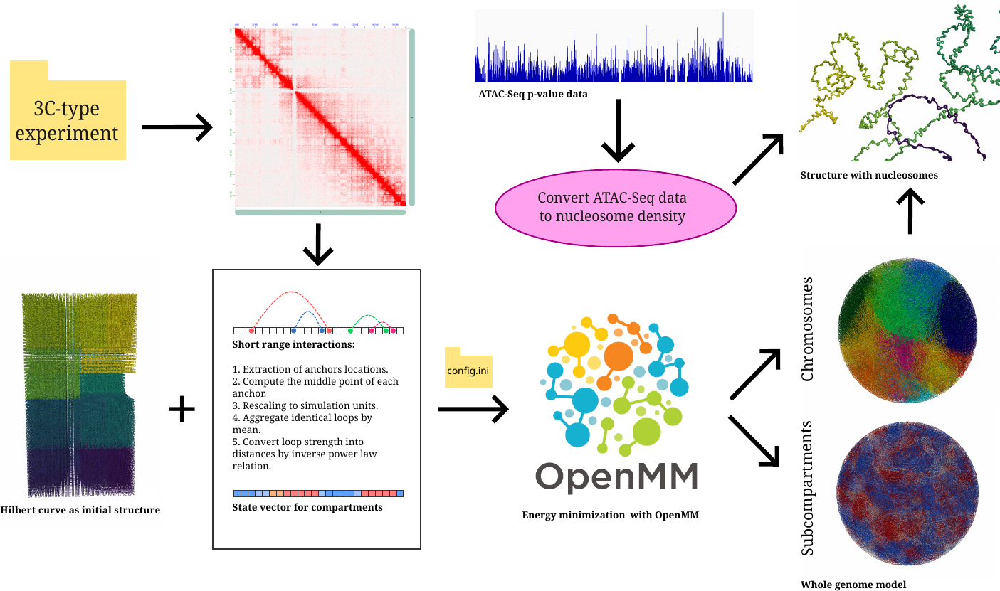
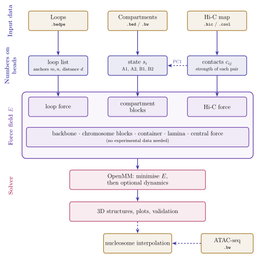

# The Model: overview

This chapter explains **what MultiMM computes**, in small steps. We describe the *energy* of the chromatin chain, term by term, and say for each term which biological fact it stands for and how it is built from data. Equations are there for those who want them, but each one comes with a sentence in plain words, so you can read the text even if you skip the formulas. Boxes titled *In MultiMM* state exactly what the program does and which settings control it. To run the program and to see the full list of settings, go to the [Reference](../reference/running.md).

## A few words you will meet

| Word | Meaning |
|---|---|
| **Bead** | One piece of the chain, standing for a stretch of the genome. |
| **Energy** | A number that tells how "unhappy" a shape is. Nature, and our program, prefer low energy. |
| **Force** | The push or pull that follows from an energy: a bead moves in the direction that lowers the energy. A *force field* is the whole collection of such terms. |
| **Minimisation** | Moving the beads step by step downhill in energy until no small move helps. |
| **$k_BT$** | The energy scale of thermal jiggling (at body temperature about 2.6 kJ/mol). An interaction much weaker than this is washed out, a much stronger one is felt. |
| **Hi-C** | An experiment that counts how often pairs of genome regions touch each other in the nucleus. |
| **Loop, TAD, compartment** | Three levels of folding seen in Hi-C: two points held together (loop), a self-contacting domain (TAD), and large active (A) or inactive (B) regions that gather with their own kind (compartments). |
| **Kernel** | A formula that says how a quantity (like attraction) changes with distance. We often offer several, and say which is the default. |

## The workflow

Data from a 3C-type experiment (loops, compartments, or the raw contact matrix) are reduced to a small set of **per-bead quantities**. These are combined with an initial structure and a configuration file, and OpenMM then minimises the energy (and optionally runs molecular dynamics). ATAC-seq enters only at the end, to refine the finished structure to nucleosome resolution.

## How the components connect

{ style="width:100%;max-width:640px" }

Read the diagram from top to bottom. Everything in the second row is a **number attached to beads or pairs of beads**, so the rest of this chapter works with exactly those objects.

## The total energy

The chromatin chain has $N$ beads at positions $\mathbf{r}_1,\dots,\mathbf{r}_N$. The distance between beads $i$ and $j$ is $r_{ij}=\lVert\mathbf{r}_i-\mathbf{r}_j\rVert$. MultiMM minimises

$$
E = E_\text{bond} + E_\text{angle} + E_\text{EV}
  + E_\text{loop} + E_\text{Hi-C}
  + E_\text{comp} + E_\text{sub} + E_\text{chrom}
  + E_\text{container} + E_\text{lamina} + E_\text{central}.
$$

Each term answers one biological question:

| Term | Question it answers | Page | Switch in the config file |
|---|---|---|---|
| $E_\text{bond}$ | Which beads are neighbours along the chain? | [Backbone](backbone.md) | `POL_USE_HARMONIC_BOND` |
| $E_\text{angle}$ | How stiff is the chromatin fibre? | [Backbone](backbone.md) | `POL_USE_HARMONIC_ANGLE` |
| $E_\text{EV}$ | Beads cannot overlap | [Backbone](backbone.md) | `EV_USE_EXCLUDED_VOLUME` |
| $E_\text{loop}$ | Which distant beads are held together by loops? | [Loops](loops.md) | `LE_USE_HARMONIC_BOND` |
| $E_\text{Hi-C}$ | Which pairs are in contact, and how strongly? | [Hi-C force](hic-force.md) | `HIC_USE_FORCE` |
| $E_\text{comp}$ | Do A and B chromatin separate? | [Compartments](compartments.md) | `COB_USE_COMPARTMENT_BLOCKS` |
| $E_\text{sub}$ | Do A1, A2, B1, B2 separate further? | [Compartments](compartments.md) | `SCB_USE_SUBCOMPARTMENT_BLOCKS` |
| $E_\text{chrom}$ | Does each chromosome form its own territory? | [Compartments](compartments.md) | `CHB_USE_CHROMOSOMAL_BLOCKS` |
| $E_\text{container}$ | Where are the walls of the nucleus? | [Nuclear envelope and lamina](lamina.md) | `SC_USE_SPHERICAL_CONTAINER` |
| $E_\text{lamina}$ | Is B chromatin pulled to the periphery? | [Nuclear envelope and lamina](lamina.md) | `IBL_USE_B_LAMINA_INTERACTION` |
| $E_\text{central}$ | Do small chromosomes sit near the centre? | [Nuclear envelope and lamina](lamina.md) | `CF_USE_CENTRAL_FORCE` |

A term whose switch is off simply does not exist in the energy.

!!! info "In MultiMM"
    Every term is added to the OpenMM `System` as its own force object and is placed in its **own force group**. That is why MultiMM can plot the energy of each term separately over a molecular dynamics run (`plots/energy_components.png`), which is the quickest way to see which force is driving the structure.

!!! warning "Combinations that are checked at start-up"
    - Lamina anchoring needs compartment labels and an active compartment (or subcompartment) force.
    - A compartment force needs a `COMPARTMENT_PATH` (or `HIC_BLOCK_COPOLYMER`, see [Hi-C force](hic-force.md)).
    - Loop bonds need a `LOOPS_PATH`; the Hi-C force needs a `HIC_PATH`.
    - Using loops, Hi-C and compartments together is allowed but triggers a warning, because the three can over-constrain the same structure.

## The simulation protocol

1. **Build.** Create the initial structure ([Initial structure](initial-structure.md)), load the data, convert it to per-bead quantities, and assemble the force field.
2. **Minimise.** OpenMM's `minimizeEnergy` moves the beads to the nearest local minimum of $E$. This produces `MultiMM_minimized.cif` and is the main result.
3. **Relax (optional, `SIM_RUN_MD`).** Molecular dynamics at temperature $T$ with a Langevin thermostat, starting from Maxwell–Boltzmann velocities. It samples fluctuations around the minimum and writes one structure per saved frame.
4. **Validate and post-process.** Compare the model with the input data (Hi-C correlations, loop distances, compartment clustering), run quality checks, make plots, and optionally add nucleosomes.

A note on strategy: because the Hilbert-curve start is already compact and ordered, minimisation alone is usually enough for large systems, while molecular dynamics is most useful for small regions where you want an ensemble of conformations.

## Notation

| Symbol | Meaning |
|---|---|
| $N$ | Number of beads (`N_BEADS`) |
| $i,\,j$ | Bead indices, $1\le i,j\le N$ |
| $r_{ij}$ | Distance between beads $i$ and $j$ |
| $b_0$ | Bond length, the basic length unit (`POL_HARMONIC_BOND_R0`) |
| $k_BT$ | Thermal energy, $\approx 2.58$ kJ/mol at 310 K |
| $s_i$ | Compartment state of bead $i$ ($\pm1,\pm2$, or $0$ if unknown) |
| $\chi_i$ | Chromosome label of bead $i$ |
| $c_{ij}$ | Hi-C contact strength between beads $i$ and $j$, scaled to $[0,1]$ |
| $\delta(a,b)$ | Kronecker delta: 1 if $a=b$, otherwise 0 |
| $\Theta(x)$ | Step function: 1 for $x>0$, otherwise 0 |
| $R_1,\,R_2$ | Inner and outer radius of the nuclear shell |

All lengths, energies and scales are defined in [Units and scales](scales.md).
