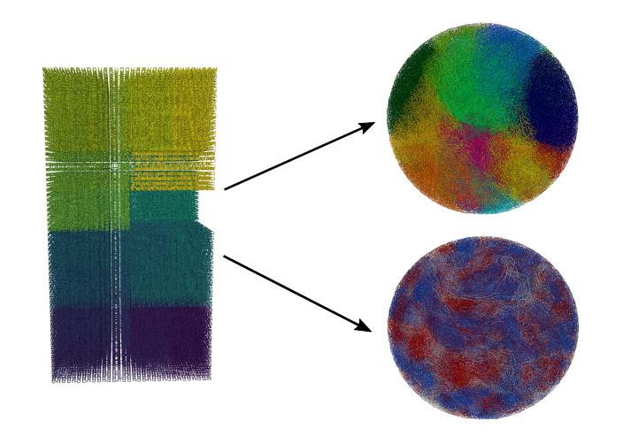

# Initial structure

Energy minimisation is a *local* search: it slides downhill from wherever it starts. For a chain of tens of thousands of beads, a random starting coil is badly knotted and the optimiser gets trapped in poor minima. MultiMM therefore starts from a **designed** conformation that is already compact and ordered. The default is a Hilbert curve.

!!! tip "In plain words"
    Finding the best folding is easier if you start from a tidy, compact fold than from a tangled mess. The Hilbert curve is such a tidy fold: a path that winds through a cube without ever crossing itself.

## Why do we need a starting structure at all?

The computer cannot find the answer in one step. It has to **start from a guess** and improve it, like a hiker who is dropped somewhere in the mountains and walks downhill to find a valley. The energy $E$ of the chain is a landscape over all the bead positions, with many valleys, most of them not very deep. The valley we end up in depends on where we started.

If the starting guess is a tangled random coil, the chain is full of knots that cannot be undone, because beads cannot pass through each other, and the hiker gets stuck in a poor valley. If the guess is already neat and compact, the hiker only needs a small walk to reach a good one. This is also faster, which matters for chains of tens of thousands of beads. So the starting structure is not the answer; it is a **good place to start looking**.

## The Hilbert curve

A Hilbert curve is a continuous path that visits every point of a cubic lattice exactly once. In three dimensions with order $p$, the lattice has $2^p\times2^p\times2^p$ points, and the curve is a map

$$
H:\{0,1,\dots,2^{3p}-1\}\;\longrightarrow\;\{0,\dots,2^p-1\}^3 .
$$

Two properties make it ideal as a chromatin starting point:

1. **Chain connectivity.** Consecutive points are always lattice neighbours, $\lVert H(d+1)-H(d)\rVert_1 = 1$, so the chain never has to stretch to stay connected.
2. **Locality and nesting.** The first $8^k$ points fill a cube of side $2^k$ completely, and points that are close along the curve stay close in space. A stretch of consecutive beads (a chromosome) therefore occupies a compact, contiguous region. This is exactly the picture of **chromosome territories**, and it is also why the curve resembles the *fractal globule*, a knot-free compact polymer state often used to describe chromatin.

!!! info "In MultiMM"
    MultiMM takes the first $N$ points of a 3D Hilbert curve of order $p=8$ (a $256^3$ lattice) and uses them as bead positions. The lattice spacing is one unit, which is written to the structure file as 1 Å $=0.1$ nm, the same as the bond length $b_0$ (see [Units and scales](scales.md)). The chain therefore starts with bonds that are already at their rest length.

    The bounding cube of the curve has volume about $N b_0^3$, whereas the nuclear sphere has volume $\tfrac{4\pi}{3}R_2^3\approx4.2\,N b_0^3$. The initial structure thus fills roughly a quarter of the container: compact, but with room to expand and rearrange.

In a genome-wide run all chromosomes are concatenated into **one chain**, with one block of beads per chromosome. Bonds and angles are not applied across chromosome boundaries, so chromosomes remain separate polymers although they share one Hilbert curve. With `SHUFFLE_CHROMS = True` the order of chromosomes along the chain is randomised before the curve is laid down (seeded by `SHUFFLING_SEED`), which changes which chromosomes start as neighbours. This is useful for ensembles, because the final arrangement of territories should not depend on an arbitrary order.

## Alternative starting structures

All other options place beads with a nominal step of one unit ($=b_0$). They are mostly useful for testing, for ensembles that should forget the Hilbert order, or for small regions where compaction is not an issue.

| `INITIAL_STRUCTURE_TYPE` | Construction | Typical use |
|---|---|---|
| `hilbert` (default) | First $N$ points of a 3D Hilbert curve | Large regions, chromosomes, whole genome |
| `rw` | Random walk: each step has unit length in a uniformly random direction | Ensembles; small regions |
| `self_avoiding_rw` | Random walk that rejects steps landing within $2\times0.5-\varepsilon$ of an earlier bead | Small systems (the rejection test scales as $N^2$, so it is slow for large $N$) |
| `confined_rw` | Random walk with steps $\pm1$ along each axis, clipped to a box of half-width 5 | Small, already compact starts |
| `circle` | Beads on a circle of radius 5 with a slow drift along $z$ | Testing |
| `helix` | $\mathbf r(\theta)=(\cos\theta,\sin\theta,z)$ with two full turns | Testing |
| `spiral` | Helix whose radius grows linearly with the bead index | Testing |
| `sphere` | Beads placed uniformly at random inside a ball | Testing |
| `knot` | Trefoil knot, $\mathbf r(t)=5\,(\sin t+2\sin 2t,\;\cos t-2\cos 2t,\;-\sin 3t)$ | Testing |

!!! note "Random starts are not connected chains"
    Unlike the Hilbert curve, the `sphere` start places beads independently, so consecutive beads are not at bond distance. The very first minimisation steps then mostly pull the chain together. All other types give a connected chain.

## Using your own structure

To start from an existing structure, set `BUILD_INITIAL_STRUCTURE = False` and point `INITIAL_STRUCTURE_PATH` to a `.cif` file with the same number of beads as `N_BEADS`. This is how you continue from a previous result or compare different force fields from an identical start.

!!! info "In MultiMM"
    | Key | Effect |
    |---|---|
    | `INITIAL_STRUCTURE_TYPE` | Choose the construction above |
    | `BUILD_INITIAL_STRUCTURE` | `True`: build a new structure. `False`: read `INITIAL_STRUCTURE_PATH` |
    | `INITIAL_STRUCTURE_PATH` | Existing `.cif` structure |
    | `SHUFFLE_CHROMS`, `SHUFFLING_SEED` | Randomise chromosome order (genome-wide runs) |

    The structure that is actually used is saved as `metadata/MultiMM_init.cif`.
