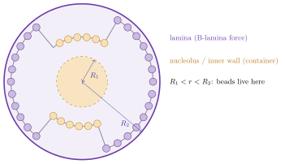
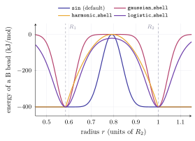
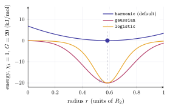

# Nuclear organisation and lamina

At genome scale, chromatin is not free: it sits inside the **nucleus**, and its position is not random. Heterochromatin (B) is enriched at the **nuclear lamina**, the protein mesh lining the nuclear envelope, while small, gene-rich chromosomes tend to sit toward the interior near the nucleolus. MultiMM encodes this with three optional radial forces. All of them act on the distance $r$ of a bead from the centre of mass of the structure.

!!! tip "In plain words"
    The nucleus is a ball with a wall (the **lamina**) and, in the middle, a dense region (the **nucleolus**). Inactive chromatin likes to cling to the walls, while small chromosomes like to sit toward the centre. The forces on this page just express these preferences.

{ width="520" }

The sketch is a schematic. One chromosome (bead chain) is shown: its B segments (purple) stay near the lamina and its A segments (gold) farther inside. In the model the sizes follow from the number of beads (see [Units and scales](scales.md)): $R_2=b_0N^{1/3}$ is the nuclear radius and $R_1=0.2^{1/3}R_2\approx0.58R_2$ is the radius of the inner region, which corresponds to **20% of the nuclear volume** and plays the role of the nucleolus.

## Spherical container

Beads are confined to the shell $R_1<r<R_2$ by a soft wall on both sides:

$$
U_\text{container}(r)=C\,\bigl[\max(0,\,r-R_2)^2+\max(0,\,R_1-r)^2\bigr],
$$

with $C=$ `SC_SCALE`. Inside the shell the energy is zero; outside it grows quadratically, so the wall is a harmonic one, and strong ($C=1000$ by default).

!!! info "In MultiMM"
    | Key | Default |
    |---|---|
    | `SC_USE_SPHERICAL_CONTAINER` | `False` (the genome-wide preset `GW` switches it on) |
    | `SC_SCALE` ($C$) | 1000.0 |

    `SC_RADIUS1` and `SC_RADIUS2` exist in the configuration but are **not used**: the radii always follow from $N$.

!!! question "Why this force, and what does it model?"
    The nucleus has a boundary, and chromatin cannot leave it. A soft wall is the simplest way to say this: the energy is zero inside and rises quickly outside, so beads can move freely in the nucleus but are pushed back at its edge. The inner wall plays the role of the nucleolus, which chromatin avoids.

## B-lamina interaction

Only **B beads** ($s_i=-1$ or $-2$) feel this force (A beads and unassigned beads have zero energy). It pulls B chromatin toward the lamina. Four radial profiles are available (`BLAMINA_FORCE_TYPE`); $B=$ `IBL_SCALE`, $r_0=\tfrac12(R_1+R_2)$ is the middle of the shell.

{ width="560" }

| `BLAMINA_FORCE_TYPE` | Energy of a B bead | Character |
|---|---|---|
| `sin` (**default**) | $B\left[\sin^8\!\left(\pi\frac{\bar r-R_1}{R_2-R_1}\right)-1\right]$, $\bar r=\min(\max(r,R_1),R_2)$ | Minimum $-B$ at **both** walls and maximum $0$ in the middle of the shell. The high power makes the wells narrow. Outside the shell $r$ is clamped, so the energy stays at $-B$ (no periodic bumps). |
| `gaussian_shell` | $-B\left[e^{-\frac{(r-R_1)^2}{2\sigma^2}}+e^{-\frac{(r-R_2)^2}{2\sigma^2}}\right]$, $\sigma=0.1(R_2-R_1)$ | Two Gaussian wells of depth $B$ at the walls, vanishing away from them. |
| `harmonic_shell` | $-B\,\left[\dfrac{\min(\lvert r-r_0\rvert,\,h)}{h}\right]^2$, $r_0=\tfrac12(R_1+R_2)$, $h=\tfrac12(R_2-R_1)$ | An inverted parabola: $0$ at mid-shell, $-B$ at the walls, flat $-B$ outside. The broadest attraction of the four. |
| `logistic_shell` | $-B\left[\operatorname{sech}^2\!\frac{r-R_1}{2\lambda}+\operatorname{sech}^2\!\frac{r-R_2}{2\lambda}\right]$, $\lambda=0.1(R_2-R_1)$ | Two smooth (logistic-derivative) wells of depth $B$ at the walls with soft tails. |

All four share the same logic: the **maximum is in the middle of the shell** and the **minima ($-B$) sit at the radii $R_1$ and $R_2$**. They differ only in how wide and how sharp the wells are. Here $\operatorname{sech}x=1/\cosh x$.

!!! info "In MultiMM"
    | Key | Default |
    |---|---|
    | `IBL_USE_B_LAMINA_INTERACTION` | `False` (requires `COMPARTMENT_PATH`; switched on by the `GW` preset when a compartment file is given) |
    | `BLAMINA_FORCE_TYPE` | `sin` |
    | `IBL_SCALE` ($B$) | 400.0 kJ/mol |

!!! question "Why this force, and what does it model?"
    Heterochromatin is attached to the lamina through proteins, so B beads feel a well near the wall. The different forms only change how wide and how sharp this well is.

## Central force (chromosome-size positioning)

Small chromosomes are found closer to the interior, large ones toward the periphery. The central force reproduces this with a bias that depends on chromosome size. Each bead carries a weight $\chi_i\in[0,1]$ given by its chromosome length, rescaled so that the shortest chromosome has $\chi=1$ and the longest $\chi=0$, i.e. the force acts mostly on small chromosomes. With $G=$ `CF_STRENGTH` and $\sigma$, $\lambda$ derived from $R_1$:

{ width="560" }

| `CENTRAL_FORCE_TYPE` | Energy of bead $i$ | Character |
|---|---|---|
| `harmonic` (**default**) | $G\chi_i\,(r-R_1)^2$ | A parabola whose minimum (energy $0$) sits exactly at $R_1$; all three forms have their minimum at $R_1$: small chromosomes are pulled toward the nucleolus surface from both sides, and pay a penalty $G\chi_i(r-R_1)^2$ for straying. |
| `gaussian` | $-G\chi_i\,e^{-(r-R_1)^2/(2\sigma^2)},\ \sigma=0.3R_1$ | A Gaussian well with its minimum $-G\chi_i$ at $R_1$: the energy slopes down gently and flattens smoothly into the minimum, so small chromosomes are drawn to the nucleolus surface. |
| `logistic` | $-G\chi_i\,\operatorname{sech}^2\!\big((r-R_1)/\lambda\big),\ \lambda=0.25R_1$ | A bell-shaped well (hyperbolic secant squared) with its minimum $-G\chi_i$ at $R_1$. It has longer tails than the Gaussian, so the pull is felt from further away and increases smoothly toward $R_1$. |

!!! info "In MultiMM"
    | Key | Default |
    |---|---|
    | `CF_USE_CENTRAL_FORCE` | `False` |
    | `CENTRAL_FORCE_TYPE` | `harmonic` |
    | `CF_STRENGTH` ($G$) | 20.0 kJ/mol |

    The chromosome weights $\chi_i$ come from the chromosome lengths of the model, so this force needs a multi-chromosome (genome-wide) run to be meaningful.

!!! question "Why this force, and what does it model?"
    Gene-poor, large chromosomes tend to be near the periphery and small, gene-rich ones in the interior, a trend seen in many cell types. We express it with a bias that grows as the chromosome gets smaller: a weak pull towards the centre, so it nudges the arrangement without forcing it.

!!! tip "Typical genome-wide setup"
    Container on, B-lamina on (with a compartment file), central force off. This is what the `GW` preset configures; see [Advanced options](advanced.md).
