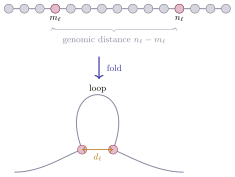
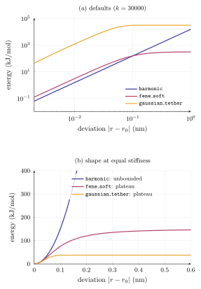

# Loops

A chromatin **loop** is a pair of genomic positions, usually bound by CTCF and cohesin, that touch frequently although they are far apart along the chromosome. Loops are the main source of short- and medium-range structure in MultiMM: they create loops, nested loops and, through their clustering, TAD-like domains.

!!! tip "In plain words"
    A loop is like tying two far-apart points of a long rope together with a short elastic band. The rest of the rope bulges out in between, and that bulge is the loop.

MultiMM models each loop as a **bond between two distant beads**.

{ width="360" }

## From loop calls to a loop list

The input is a `.bedpe` file in which every row lists the two anchors of a loop and a strength (a contact count, a peak score, or 1 for single-cell data); see [Input data](../reference/input.md). The rows are turned into triples $(m_\ell,\,n_\ell,\,d_\ell)$: the two anchor beads of loop $\ell$ and its target distance.

1. **Select** the loops that lie entirely inside the modelled region. In a genome-wide run the chromosomes are placed one after another on a single axis.
2. **Take anchor midpoints.** Anchors are intervals but a bead is a point, so each anchor is reduced to its midpoint.
3. **Rescale to beads.** A genomic coordinate becomes a bead index by dividing by the resolution ([Units and scales](scales.md)).
4. **Aggregate.** Loops that land on the same pair of beads are merged and their strengths averaged into one value $c_\ell$. Loops whose anchors are closer than three beads ($n_\ell\le m_\ell+2$) are dropped: the backbone already holds such beads together.
5. **Convert strength to distance** (below).

## From strength to distance

A strong loop means frequent contact, so a short distance. Hi-C contact frequency falls with distance roughly as a power law, which can be inverted: the stronger the loop, the shorter the distance. MultiMM uses

$$
d_\ell \;=\; 0.1 + 0.1\,\tilde c_\ell\ \text{nm},\qquad
\tilde c_\ell=\operatorname{minmax}\!\left(c_\ell^{-2/3}\right)\in[0,1],
$$

where $\operatorname{minmax}$ rescales the values over all loops to $[0,1]$. The strongest loop gets 0.1 nm and the weakest 0.2 nm: **strength only orders the distances inside a narrow range**, and every loop pulls its anchors close together.

!!! warning "Loops of equal strength"
    If all loops have the same strength (typical for single-cell data where strength is 1) the rescaling is undefined and the code sets every $d_\ell=1$ nm, which is *not* a tight loop. For such data set `LE_FIXED_DISTANCES = True`: every loop then uses `LE_HARMONIC_BOND_R0` instead.

## The loop force

Each loop is a bond with rest length $r_0=d_\ell$ (or `LE_HARMONIC_BOND_R0` if `LE_FIXED_DISTANCES = True`) and stiffness $k$ (`LE_HARMONIC_BOND_K`). Write $x=r_{m_\ell n_\ell}-r_0$ for the deviation from the target. Three shapes are available, selected with `LE_LOOP_FORCE_TYPE`:

{ width="560" }

| `LE_LOOP_FORCE_TYPE` | Energy per loop | Behaviour |
|---|---|---|
| `harmonic` (**default**) | $\dfrac{k}{2}\,x^2$ | Classic spring. The restoring force grows without limit as the loop is stretched, so every loop is enforced strictly. Best when you trust the loop calls. |
| `fene_soft` | $\dfrac{k\,x^2}{1+\alpha x^2},\ \alpha=\dfrac1{r_0^2}$ | Quadratic for small $x$ (note: $k x^2$, *twice* the harmonic stiffness) but **saturates** at $k\,r_0^2$ (300 kJ/mol for the defaults). A badly violated loop stops pulling harder. |
| `gaussian_tether` | $k\left(1-e^{-x^2/\sigma^2}\right),\ \sigma=\dfrac{r_0}{2}$ | A smooth well that is zero at the target and **flat at $k$ far away** (30 000 kJ/mol for the defaults, but note that this plateau is an *energy*, while for the other two $k$ is a spring constant). The force vanishes for very stretched loops, and near the target the curvature is $4k/r_0^2$, which is much stiffer than the others. |

The two bounded forms are meant for noisy or partly inconsistent loop sets (loops from different cells, false positives): with a harmonic bond one wrong loop can distort the structure, while a bounded bond limits the damage. Because $k$ means different things in the three forms, **re-tune `LE_HARMONIC_BOND_K` when you switch the form**.

!!! note "Loops here are static restraints"
    The prefix `LE` comes from *loop extrusion*, the mechanism that forms loops in cells, but MultiMM does not simulate cohesin moving along DNA. It places one **fixed bond for every observed loop**, and the structure is the best arrangement consistent with all of them.

## Why do loops make TADs?

A bond between two beads pins a loop in the chain. Many loops with anchors in the same neighbourhood hold a stretch of chromatin in a compact cluster while beads outside are free to move away. After minimisation this is a **domain** with many internal contacts and a clear boundary, which is the TAD signal in a Hi-C map. Domain boundaries in a MultiMM structure therefore come from where the loop anchors lie.

!!! question "Why this force, and what does it model?"
    Loops are made by proteins (cohesin and CTCF) that hold two sites together. In the model we do not simulate the proteins; we only say *the sites are held at a short distance*, with a spring. Each loop is a measured fact, so the spring is the minimal way to put that fact into the structure. The softer forms (`fene_soft`, `gaussian_tether`) exist because a pure spring can pull very hard if a loop is not consistent with the rest of the data, and a bounded force is gentler.

## Choices in the data

| Choice | Effect |
|---|---|
| Assay (HiCCUPS, ChIA-PET, HiChIP, CTCF/cohesin) | Decides which loops exist. ChIA-PET and HiChIP loops are sparse and strong; Hi-C loop calls are denser. |
| Strength column | Only the *ranking* of strengths matters (above). |
| `LE_FIXED_DISTANCES` | `True`: all loops use `LE_HARMONIC_BOND_R0`. `False` (default): distance from strength. |
| `DOWNSAMPLING_PROB` | Keeps a random fraction of the loops, so each [ensemble](advanced.md) member uses a different subset. |

!!! info "In MultiMM"
    | Key | Default | Role |
    |---|---|---|
    | `LOOPS_PATH` | none | `.bedpe` file with loops. **Required** while `LE_USE_HARMONIC_BOND` is `True`. |
    | `LE_USE_HARMONIC_BOND` | `True` | Add loop bonds |
    | `LE_LOOP_FORCE_TYPE` | `harmonic` | Bond shape |
    | `LE_HARMONIC_BOND_K` | 30 000 kJ mol⁻¹ nm⁻² | Stiffness $k$ |
    | `LE_HARMONIC_BOND_R0` | 0.1 nm | Distance when `LE_FIXED_DISTANCES = True` (also the EV size $\sigma$) |
    | `LE_FIXED_DISTANCES` | `False` | Fixed or strength-derived distances |
    | `DOWNSAMPLING_PROB` | 1.0 | Fraction of loops kept |

    The anchors and distances actually used are saved as `metadata/ms.npy`, `ns.npy` and `ds.npy`, and a loop-validation summary as `metadata/loop_validation.npy`.
